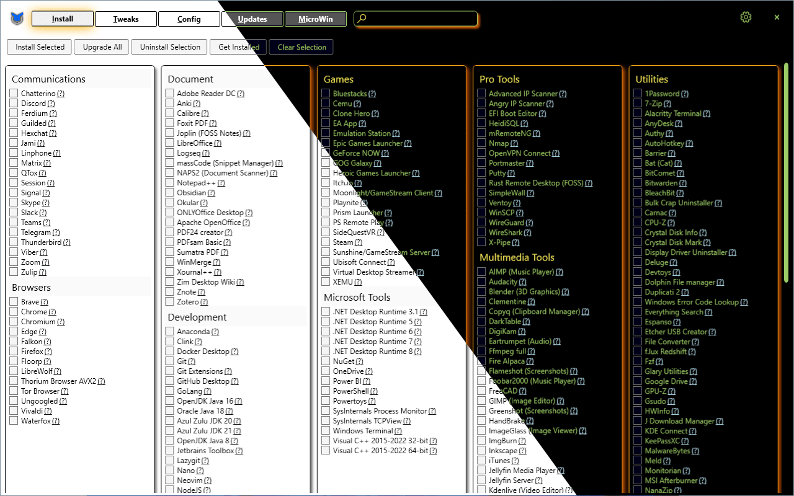

# Debloat Windows with WinUtil

You can uninstall apps one at a time from **Settings › Apps**, but that misses
the services, scheduled tasks and leftover files that come with them.
[WinUtil](https://github.com/ChrisTitusTech/winutil) handles all of that from a
single window. It debloats, applies privacy and performance tweaks, and can
install software in bulk.

<Steps>
  <Step title="Open an elevated terminal">
    Right-click Start and choose **Terminal (Admin)**. On Windows 10 the entry is
    **Windows PowerShell (Admin)**. You can also search for "Terminal" and press
    <Kbd>Ctrl</Kbd> + <Kbd>Shift</Kbd> + <Kbd>Enter</Kbd>.
  </Step>
  <Step title="Launch WinUtil">
    ```powershell
    irm "https://christitus.com/win" | iex
    ```

    The window opens on the **Install** tab. Debloating is under **Tweaks**.

    
  </Step>
  <Step title="Pick a level of tweaks">
    Under **Tweaks**, start from the *Standard* preset and add only the extra
    tweaks you understand. Each one says what it changes.
  </Step>
</Steps>

<Callout type="warning" title="Read before you pipe">
  `irm … | iex` runs a remote script with administrator rights. Check that the
  URL is the one in the project's README, and create a restore point first.
  WinUtil offers to create one for you.
</Callout>

The same window can also install software in bulk. See
[package managers](/stash/workstation/systems/windows/package-managers).
