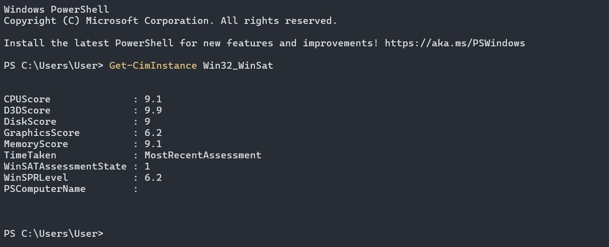

# Windows hardware score with WinSAT

Windows still benchmarks its hardware with WinSAT, even though the score no
longer appears anywhere in the UI. You can read it from PowerShell:

```powershell
Get-CimInstance Win32_WinSat
```



Scores range from **1.0** to **9.9**. The lowest component score points to the
upgrade that will help most:

| Low score | What it suggests |
| --- | --- |
| `DiskScore` | Move to an SSD, preferably NVMe |
| `MemoryScore` | More RAM, or faster RAM |
| `CPUScore` | A newer CPU |
| `GraphicsScore` / `D3DScore` | A better GPU, if your work needs one |

Anything at 7 or below is worth a look on a machine used for heavy work.

<Callout type="note" title="Stale or missing scores">
  The numbers come from the last assessment that ran. After a hardware change,
  or when the results are empty, run a fresh one from an elevated terminal:

  ```powershell
  winsat formal
  ```
</Callout>
