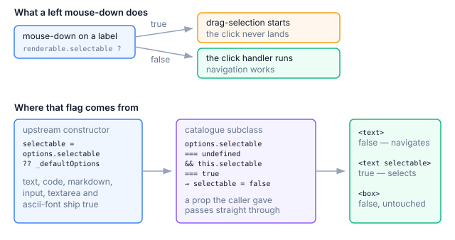

# Making drag-selection opt-in

In a terminal UI where most labels are also click targets, pressing the mouse
down on a label and moving a cell or two highlights text rather than navigating.
Release, and the click has become a selection.

That is OpenTUI behaving as designed. The renderer turns a left mouse-down over
a selectable renderable into a drag-selection, and every text-bearing
renderable ships `selectable: true`, including `<text>`, `<code>`,
`<markdown>`, `<input>`, `<textarea>` and `<ascii-font>`. The base
`Renderable` is `false`, and they override it.

Some places still want selection. A log view or a console pane has to be
copyable. So the fix flips the default while keeping the prop meaningful. A
renderable given no `selectable` prop comes up non-selectable, and one given
the prop gets exactly what the caller asked for.



## Where the default lives

`selectable` is resolved inside each renderable's own constructor:

```typescript
this.selectable = options.selectable ?? this._defaultOptions.selectable;
```

`_defaultOptions` is a class *field*, so each instance gets its own copy during
construction. Nothing on the prototype can change it, and nothing outside the
constructor can get in front of that line. Subclassing is the only seam.

0.6.0 moved `selectable` itself onto `Renderable.prototype`, as an accessor
backed by the renderable's native scene hooks rather than a plain instance
field. That does not open a new seam. The line above still runs in the
constructor and still writes through that accessor, so redefining the
descriptor would only intercept a write whose value has already been decided.
Correcting the flag after `super()` remains the way in.

## The dead end

The obvious one-liner disables the renderer's selection entirely:

```typescript
renderer.startSelection = () => {};
```

Selection then stops everywhere, including on the `<text selectable>` that
wants it, and the prop silently means nothing. Anyone reading the component
later sees a `selectable` that the type system accepts and the runtime ignores,
which is worse than the original problem.

## Subclassing the catalogue

`@opentui/react` keeps a catalogue mapping an element name to the renderable
class the reconciler constructs. `getComponentCatalogue()` reads it, `extend()`
writes it, and the reconciler builds every entry the same way:

```typescript
new Component(ctx, { id, ...props });
```

So a uniform `(ctx, options)` subclass is safe for all of them. The patch wraps
each entry in a subclass that lets the real constructor run and then corrects
the flag:

```typescript
optIn[name] = class extends Base {
  constructor(ctx: RenderContext, options: { selectable?: boolean }) {
    super(ctx, options);
    if (options?.selectable === undefined && this.selectable === true) {
      this.selectable = false;
    }
  }
};
```

Both halves of that condition matter. `options?.selectable === undefined` is
what makes this a default rather than a ban, so `selectable={false}` and
`selectable` both pass straight through. `this.selectable === true` leaves
alone everything that never opted in: `<box>`, span nodes, and anything whose
`_defaultOptions` already said `false`.

<Callout type="warning">
  Wrap `getComponentCatalogue()`, never the pristine `baseComponents`. Two
  patches that both wrap the pristine set and call `extend()` will re-register
  the same names over each other, and the second one silently deletes the
  first. Wrapping what is currently registered lets them compose in either
  order.
</Callout>

## The text fields keep their own selection

The patch leaves `<input>` and `<textarea>` as upstream built them. The field
itself is a box, and the selection inside it belongs to its text buffer rather
than to the renderer's drag-selection, so flipping the flag there breaks
selecting inside a field without fixing anything. They are the default of
`keep`, and the option exists because the right set depends on which
renderables an app treats as text entry.

## The module

```typescript title="selection-opt-in.ts" showLineNumbers
/**
 * Make drag-selection opt-in across a whole OpenTUI app.
 *
 * OpenTUI's text-bearing renderables ship `selectable: true`, and the renderer
 * turns a left mouse-down over one into a drag-selection. In a UI where labels
 * are click targets, that fights navigation. This flips the *default*: a
 * renderable given no `selectable` prop comes up non-selectable, one given the
 * prop keeps what the caller asked for.
 *
 * Install once, before the first render.
 */

import type { RenderContext } from "@opentui/core";
import {
  extend,
  getComponentCatalogue,
  type RenderableConstructor,
} from "@opentui/react";

/** The `selectable` flag seen from outside the renderable class hierarchy. */
interface MaybeSelectable {
  selectable?: boolean;
}

/**
 * A catalogue entry seen structurally. `RenderableConstructor` resolves to the
 * *abstract* `BaseRenderable`, which TypeScript refuses to subclass in a class
 * expression, so the base is narrowed to what this wrapper touches.
 */
type SelectableConstructor = new (
  ctx: RenderContext,
  options: { selectable?: boolean },
) => MaybeSelectable;

export interface SelectionOptInOptions {
  /**
   * Catalogue names to leave exactly as upstream built them. Text entry
   * belongs here: an `<input>` is a box whose selection is owned by its own
   * text buffer, not by the renderer's drag-selection.
   */
  keep?: readonly string[];
}

const DEFAULT_KEEP = ["input", "textarea"] as const;

let patched = false;

/**
 * Re-register the component catalogue so `selectable` defaults to `false`.
 * Call once, before the first render; a second call is a no-op.
 *
 * Wraps the **currently registered** catalogue rather than the pristine
 * `baseComponents`, so it composes with other catalogue patches in either
 * order instead of replacing them.
 */
export function installSelectionOptIn(
  options: SelectionOptInOptions = {},
): void {
  if (patched) return;
  patched = true;

  const keep = new Set(options.keep ?? DEFAULT_KEEP);
  const optIn: Record<string, RenderableConstructor> = {};

  for (const [name, Base] of Object.entries(getComponentCatalogue()) as [
    string,
    SelectableConstructor,
  ][]) {
    if (keep.has(name)) continue;

    optIn[name] = class extends Base {
      constructor(ctx: RenderContext, props: { selectable?: boolean }) {
        super(ctx, props);

        // Prop given → the caller decides. Prop absent → off, but only for
        // classes that opted themselves in; leave everything else as built.
        if (props?.selectable === undefined && this.selectable === true) {
          this.selectable = false;
        }
      }
    } as unknown as RenderableConstructor;
  }

  extend(optIn);
}
```

Skipping a kept name rather than wrapping it keeps the entry the catalogue
already holds, which matters when another patch has wrapped it first.

## Installing it

The reconciler reads the catalogue as it constructs elements, so the call has
to land before the first render:

```typescript title="render-app.ts"
import { installSelectionOptIn } from "./selection-opt-in.ts";

export async function renderApp() {
  installSelectionOptIn();

  const renderer = await createCliRenderer({ enableMouseMovement: true });
  createRoot(renderer).render(<App />);
}
```

After that, a component asks for selection where it wants it:

```tsx
{/* Inert: a click navigates, a drag does nothing. */}
<text>{server.name}</text>

{/* Selectable: log lines can be highlighted and copied. */}
<text selectable>{line}</text>
```

## When it can go

Upstream would need a way to set the default from outside the constructor,
either a renderer option or a `selectable` that reads a context value instead
of a class field. Either one removes the need for the subclass wrapper.

Still required as of `@opentui/core` 0.6.6, and the module runs unchanged
there. Constructing each catalogue class directly on 0.6.6 and reading the flag
back gives `true` for `text`, `code`, `input`, `textarea` and `ascii-font`, and
`false` for `box` and `scrollbox`, exactly as on 0.5.x. Mounting the patched
catalogue leaves `<text>` at `false`, `<text selectable>` at `true` and
`<text selectable={false}>` at `false`.

## Related entries

- [Terminal-relative dimensions](/stash/opentui/patches/negative-dimension-patch). Uses the same catalogue seam, for a prop upstream rejects outright.
- [Clipping box borders](/stash/opentui/patches/box-clip-patch). A prototype patch rather than a catalogue one, and the reason why. Resolved upstream in 0.6.0.
