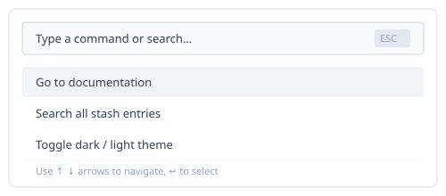

# Accessible Command Menu

A command menu (often invoked with `Cmd+K` or `Ctrl+K`) provides instant, keyboard-driven access to commands, documentation entries, and settings.

## Overview

This implementation focuses on accessibility, predictable focus management, and minimal client overhead.



## Keyboard Navigation

Keyboard interactions must strictly follow WAI-ARIA guidelines for modal dialogs and listboxes:

- `ArrowDown`: Moves active selection to the next item, wrapping at the bottom.
- `ArrowUp`: Moves active selection to the previous item, wrapping to the end.
- `Enter`: Executes the active command and closes the dialog.
- `Escape`: Cancels and closes the menu, returning focus to the trigger.

## Component Code

The complete component implementation is located in [`command-menu.tsx`](./command-menu.tsx):

```tsx
import { CommandMenu } from "./command-menu";

export function AppHeader() {
  const [isOpen, setIsOpen] = useState(false);

  return (
    <>
      <button onClick={() => setIsOpen(true)}>Open Palette (⌘K)</button>
      <CommandMenu
        isOpen={isOpen}
        onClose={() => setIsOpen(false)}
        items={[
          { id: "1", label: "Documentation", onSelect: () => console.log("docs") },
          { id: "2", label: "Settings", onSelect: () => console.log("settings") },
        ]}
      />
    </>
  );
}
```

## Related Entries

- [useDebounce Hook](/stash/react/hooks/use-debounce) — Debounce search input inside the command menu to optimize fuzzy match performance.
- [Debounce Implementation](/stash/react/hooks/use-debounce#implementation) — Source implementation for value debouncing.
- [Type-Safe Result Pattern](/stash/typescript/patterns/result-type) — Handle command execution results with explicit success and error variants.
