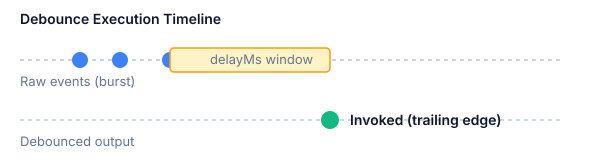

# useDebounce Hook

Debouncing delays invoking a function or updating a state value until after a designated duration has elapsed since the last time the value changed.

This is essential for real-time search queries, window resize listeners, and continuous auto-save routines.

## Overview

When a user types into a search input, triggering an API call on every keystroke overwhelms the network and UI. `useDebounce` guarantees that execution only occurs once the typing burst settles.



## Implementation

The implementation is located right beside this guide in [`use-debounce.ts`](./use-debounce.ts):

```typescript
import { useEffect, useState } from "react";

export function useDebounce<T>(value: T, delayMs: number): T {
  const [debouncedValue, setDebouncedValue] = useState<T>(value);

  useEffect(() => {
    const timer = setTimeout(() => {
      setDebouncedValue(value);
    }, delayMs);

    return () => {
      clearTimeout(timer);
    };
  }, [value, delayMs]);

  return debouncedValue;
}
```

## Usage Example

Integrate `useDebounce` into a filter or search component:

```tsx
import { useState } from "react";
import { useDebounce } from "./use-debounce";

export function SearchFilter() {
  const [query, setQuery] = useState("");
  const debouncedQuery = useDebounce(query, 300);

  return (
    <input
      type="search"
      value={query}
      onChange={(e) => setQuery(e.target.value)}
      placeholder="Type to filter results..."
    />
  );
}
```

## Related Entries

- [Command Menu Component](/stash/react/components/command-menu) — Pair with debounced search for fast palette filtering.
- [Command Menu Keyboard Controls](/stash/react/components/command-menu#keyboard-navigation) — Keyboard-driven actions for command palettes.
- [Type-Safe Result Pattern](/stash/typescript/patterns/result-type) — Handle async fetch errors cleanly.
