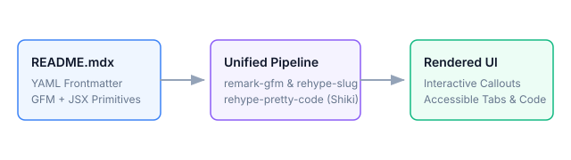

This document serves as a living testbed and reference specification for the Stash content rendering engine. It verifies typography styling, GitHub Flavored Markdown (GFM) extensions, Shiki code presentation, adjacent asset resolution, and custom interactive MDX components.

## Typography and Text Formatting

Standard prose renders with calibrated leading, readable tracking, and contextual color contrast across both light and dark themes.

### Headings and Anchor Targets

Each heading level automatically receives an accessible URL anchor slug for deep linking:

#### Level 4 Sub-heading

Heading hierarchy cascades from `h1` down to `h4`. Hovering over any `h2`, `h3`, or `h4` reveals its direct anchor permalink.

### Inline Styling and Formatting

All common Markdown inline formatting styles are fully supported:

- **Bold text**: Emphasize critical keywords with `**bold**` or `__bold__`.
- *Italic text*: Highlight subtle context or foreign terms with `*italic*` or `_italic_`.
- ***Bold and italic***: Combine both styles for strong visual emphasis.
- ~~Strikethrough~~: Depict deprecated, cancelled, or superseded items with `~~text~~`.
- `Inline code`: Render types, methods, and variables like `useMemo()`, `Record<string, unknown>`, and `process.env.NODE_ENV`.
- **Keyboard shortcuts**: Combinations such as <kbd>Ctrl</kbd> + <kbd>K</kbd> or <kbd>Cmd</kbd> + <kbd>P</kbd>.

### Hyperlinks and Navigation

Anchor tags dynamically resolve according to their destination schema:

- **External Link**: Points outside the site, opening in a secure new tab: [MDN Web Docs](https://developer.mozilla.org).
- **Internal Cross-Reference**: Routes client-side through Next.js: [useDebounce Hook](/stash/react/hooks/use-debounce).
- **Deep Anchor Link**: Jumps to a specific section within another entry: [Command Menu Keyboard Navigation](/stash/react/components/command-menu#keyboard-navigation).
- **Local In-Document Anchor**: Navigates within this guide: [Jump to Interactive Callouts](#interactive-callouts).
- **Local Adjacent File Link**: References adjacent source code: [sample-snippet.ts](./sample-snippet.ts).

### Blockquotes

Blockquotes are styled with an accent left border and muted italic typography:

> "Simplicity is prerequisite for reliability."
>
> — Edsger W. Dijkstra

Nested or multi-line blockquotes maintain consistent spacing:

> First level quotation explaining the architectural design requirement.
>
> > Nested blockquote providing supporting rationale or historical context.

---

## Lists and Task Tracking

Stash supports ordered sequences, unordered bullet hierarchies, and interactive task checkboxes.

### Unordered and Ordered Lists

1. **Primary Initialization Step**
   - Verify Bun runtime environment (`bun --version >= 1.2.0`).
   - Validate configuration files in project root.
2. **Component Registration**
   - Register base MDX element overrides.
   - Inject interactive design-system components.
3. **Evaluation and Static Assembly**
   - Compile AST via unified remark and rehype plugins.
   - Stream static HTML or hydrate interactive client islands.

### GitHub Task Lists

- [x] Define frontmatter schema with Zod validation
- [x] Configure dual-theme Shiki code highlighting
- [x] Implement accessible callouts and tabbed containers
- [ ] Add interactive live-code playground sandbox
- [ ] Implement search index export for offline browsing

---

## Tables and Structured Data

GFM tables automatically wrap in a horizontally scrollable container with styled borders, header shading, and subtle row hover highlights.

| Component | Selector Tag | Accessibility Role | Primary Use Case |
| :--- | :--- | :--- | :--- |
| **Callout** | `<Callout />` | `status` / `alert` | Highlight tips, warnings, cautions, and critical notes. |
| **Tabs** | `<Tabs />` & `<Tab />` | `tablist` / `tabpanel` | Multi-package manager commands and multi-language snippets. |
| **Details** | `<Details />` | Native `<details>` | Collapsible disclosures for deep technical breakdowns. |
| **CodeBlock** | `<CodeBlock />` | Formatted `<pre>` | Programmatic syntax highlighting with manual line highlights. |

---

## Code Presentation and Shiki Highlighting

Code blocks are pre-processed server-side with `rehype-pretty-code` and dual light/dark themes (`github-light` and `github-dark`), language badges, and one-click copy buttons.

### Filenames, Titles, and Language Badges

Add a `title="..."` attribute to display a file title bar:

```typescript title="lib/cache-manager.ts"
interface CacheEntry<T> {
  data: T;
  timestamp: number;
  ttlMs: number;
}

export class MemoryCache<T> {
  private readonly store = new Map<string, CacheEntry<T>>();

  set(key: string, data: T, ttlMs = 60_000): void {
    this.store.set(key, { data, timestamp: Date.now(), ttlMs });
  }

  get(key: string): T | null {
    const entry = this.store.get(key);
    if (!entry) return null;
    if (Date.now() - entry.timestamp > entry.ttlMs) {
      this.store.delete(key);
      return null;
    }
    return entry.data;
  }
}
```

### Line Numbers and Highlight Ranges

Combine `showLineNumbers` with `{lineRange}` to highlight specific lines:

```tsx title="components/counter.tsx" showLineNumbers {4,8-10}
import { useState } from "react";

export function Counter() {
  const [count, setCount] = useState<number>(0);

  return (
    <div className="flex items-center gap-4">
      <button type="button" onClick={() => setCount((prev) => prev - 1)}>
        Decrement
      </button>
      <span>{count}</span>
      <button type="button" onClick={() => setCount((prev) => prev + 1)}>
        Increment
      </button>
    </div>
  );
}
```

### Word and Token Highlighting

Wrap individual words or tokens in quotes to highlight every occurrence across lines:

```typescript title="hooks/use-toggle.ts" "boolean" "useCallback"
import { useCallback, useState } from "react";

export function useToggle(initialValue = false): [boolean, () => void] {
  const [value, setValue] = useState<boolean>(initialValue);
  const toggle = useCallback(() => setValue((prev) => !prev), []);
  return [value, toggle];
}
```

### Terminal Commands

Code fences with `bash`, `sh`, `shell`, or `zsh` render with a terminal icon:

```bash title="Terminal"
# Install dependencies with Bun
bun install

# Run the validation suite across all content entries
bun run validate:content

# Start the local development server
bun dev
```

### Git Diff Highlighting

Use the `diff` language identifier to clearly illustrate file changes:

```diff title="config/system.config.ts"
  export const config = {
    env: "production",
-   maxRetries: 3,
-   timeoutMs: 1500,
+   maxRetries: 5,
+   timeoutMs: 5000,
+   telemetry: true,
  };
```

### Multiple Languages

```json title="package.json"
{
  "name": "stash-demo",
  "version": "1.0.0",
  "private": true,
  "scripts": {
    "test": "bun test"
  }
}
```

```css title="styles/theme.css"
:root {
  --primary-color: #6366f1;
  --surface-ground: #0f172a;
  --transition-smooth: all 200ms cubic-bezier(0.4, 0, 0.2, 1);
}
```

```python title="scripts/generate_report.py"
def calculate_summary(metrics: list[float]) -> dict[str, float]:
    """Calculate summary statistics for given metrics."""
    return {
        "mean": sum(metrics) / len(metrics),
        "maximum": max(metrics),
        "minimum": min(metrics),
    }
```

---

## Interactive Callouts

The built-in `<Callout>` component renders styled semantic notices with Lucide icons and accessible ARIA attributes.

<Callout type="note" title="General Note">
  This is a contextual note providing background details. Supports standard Markdown like **bold text** and [internal links](/stash/react/hooks/use-debounce).
</Callout>

<Callout type="tip" title="Pro Tip: Lightning Execution">
  Use `bun test --filter mdx` to quickly run only the MDX rendering test suite without running full project checks.
</Callout>

<Callout type="warning" title="Watch Out: Server vs Client Boundary">
  MDX documents in Stash are evaluated server-side. Custom components containing React hooks or event listeners must be marked with `"use client"`.
</Callout>

<Callout type="danger" title="Destructive Action Warning">
  Deleting a content directory permanently purges all adjacent code files and images from the filesystem.
</Callout>

<Callout type="important" title="Security Requirement">
  Always sanitize dynamic user content before passing raw strings into MDX compiler pipelines.
</Callout>

A callout can also be set `compact` for a single remark that does not need a heading of its own:

<Callout type="tip" compact>
  Press <kbd>/</kbd> to jump straight to the sidebar filter.
</Callout>

---

## Interactive Tabbed Containers

The `<Tabs>` and `<Tab>` components provide accessible tabbed interfaces with keyboard navigation (<kbd>←</kbd> / <kbd>→</kbd> / <kbd>Home</kbd> / <kbd>End</kbd>).

<Tabs items={["Bun", "pnpm", "npm", "yarn"]} group="package-manager">
  <Tab value="Bun">
    ```bash
    bun add lucide-react clsx tailwind-merge
    ```
  </Tab>
  <Tab value="pnpm">
    ```bash
    pnpm add lucide-react clsx tailwind-merge
    ```
  </Tab>
  <Tab value="npm">
    ```bash
    npm install lucide-react clsx tailwind-merge
    ```
  </Tab>
  <Tab value="yarn">
    ```bash
    yarn add lucide-react clsx tailwind-merge
    ```
  </Tab>
</Tabs>

### Tabs with Mixed Content

Tabs can contain rich instructions, prose, and nested components:

<Tabs items={["Architecture", "Prerequisites"]}>
  <Tab value="Architecture">
    Content entries reside directly on the filesystem under `content/`. The pipeline automatically discovers frontmatter, builds table-of-contents trees, and checks links at build time.
  </Tab>
  <Tab value="Prerequisites">
    - Node.js 20+ or Bun 1.2+
    - Modern browser with ES2022 support
    - Git workspace with working directory clean
  </Tab>
</Tabs>

---

## Collapsible Disclosures

The `<Details>` component leverages native browser `<details>` and `<summary>` elements with an animated chevron.

<Details summary="Inspect Full Schema Definition (Default Closed)" defaultOpen={false}>
  ```typescript title="lib/content/types.ts"
  export interface ContentEntry {
    slug: string;
    permalink: string;
    title: string;
    description: string;
    frontmatter: Record<string, unknown>;
    headings: ContentHeading[];
    links: ContentLink[];
    assets: ContentAsset[];
    draft: boolean;
  }
  ```
</Details>

<Details summary="Quick Architectural Overview (Default Open)" defaultOpen={true}>
  When an entry directory contains adjacent assets such as `.svg`, `.png`, or `.ts` files, Stash identifies them automatically and exposes typed asset objects in the entry metadata.
</Details>

---

## Programmatic CodeBlock Component

In addition to standard Markdown code fences, the standalone `<CodeBlock />` component can be invoked directly as a JSX tag with programmatic props:

<CodeBlock
  code={`export function formatCurrency(cents: number): string {
  return new Intl.NumberFormat("en-US", {
    style: "currency",
    currency: "USD",
  }).format(cents / 100);
}`}
  language="typescript"
  filename="lib/currency.ts"
  showLineNumbers={true}
  highlightLines={[2, 3]}
/>

---

## Procedures

The `<Steps>` component numbers a sequence. The rail connects each marker, so a step that contains a code block still reads as part of the procedure.

<Steps>
  <Step title="Create the entry directory">
    Directory names become the route, so they are lowercase and hyphenated.

    ```bash
    mkdir -p content/react/hooks/use-interval
    ```
  </Step>
  <Step title="Write the document">
    Frontmatter is optional. Anything left out is derived from the path, the first heading, and the body.
  </Step>
  <Step title="Check it before committing">
    ```bash
    bun run validate:content
    ```
  </Step>
</Steps>

---

## Directory Structures

Content hierarchy comes from directory paths, so entries often need to describe a layout. `<FileTree>` renders one as a real tree, which keeps the names selectable and the nesting available to screen readers.

<FileTree>
  <Folder name="content">
    <Folder name="react">
      <Folder name="hooks">
        <Folder name="use-debounce" highlight>
          <File name="README.mdx" highlight comment="the entry document" />
          <File name="use-debounce.ts" comment="served as-is" />
          <File name="debounce-diagram.svg" />
        </Folder>
      </Folder>
    </Folder>
  </Folder>
  <Folder name="lib" defaultOpen={false}>
    <File name="content" comment="discovery, parsing, validation" />
    <File name="mdx" comment="compile pipeline" />
  </Folder>
</FileTree>

---

## Prop References

`<PropsTable>` documents the props of a component. It is a definition list rather than a four-column grid, because a props reference is read one entry at a time and a wide table collapses badly on a phone. Row text is plain text, not Markdown.

<PropsTable
  of="<Callout />"
  rows={[
    {
      name: "type",
      type: "note | tip | warning | danger | important",
      default: "note",
      description: "Which notice to show. info and caution are accepted as aliases.",
    },
    {
      name: "title",
      type: "string",
      description: "Replaces the default heading for the chosen type.",
    },
    {
      name: "compact",
      type: "boolean",
      default: "false",
      description: "Renders on a single line, for a one-sentence aside.",
    },
  ]}
/>

---

## Cross References

When the next thing to read deserves more than an inline link, `<CardGrid>` and `<LinkCard>` give it a target.

<CardGrid>
  <LinkCard
    href="/stash/react/hooks/use-debounce"
    eyebrow="react/hooks"
    title="useDebounce"
    description="Debouncing rapidly updating values."
  />
  <LinkCard
    href="/stash/typescript/patterns/result-type"
    eyebrow="typescript/patterns"
    title="Result type"
    description="Error handling without exceptions."
  />
</CardGrid>

---

## Adjacent Assets and Media

Stash seamlessly tracks adjacent media and source files located in the same directory as the `README.mdx`.

### Vector Diagram Asset

Below is an adjacent SVG file rendered via standard Markdown image syntax (``):



### Adjacent Code Asset Reference

The accompanying sample snippet [`sample-snippet.ts`](./sample-snippet.ts) is colocated right beside this document:

```typescript title="sample-snippet.ts"
export interface KitchenSinkMetric {
  id: string;
  name: string;
  value: number;
  status: "idle" | "running" | "completed";
}
```

---

## Related Entries and Cross References

- [useDebounce Hook](/stash/react/hooks/use-debounce) — Debouncing rapidly updating state values.
- [Command Menu Component](/stash/react/components/command-menu) — Fast, accessible command palette dialog.
- [Type-Safe Result Pattern](/stash/typescript/patterns/result-type) — Ergonomic error handling with algebraic result types.
